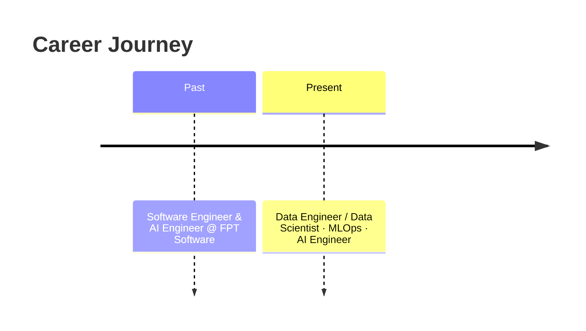
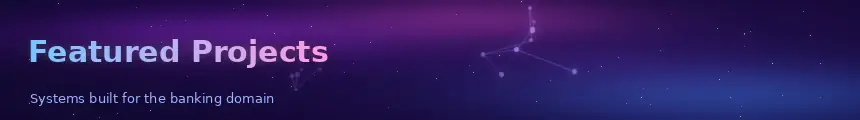
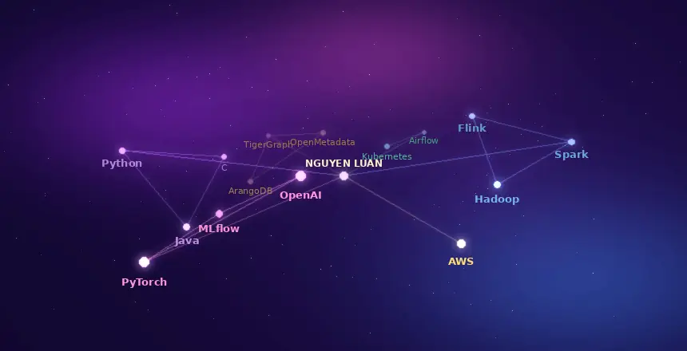

  
  
  

Hello, and thank you for visiting my profile! I am an engineer who works across **software engineering, artificial intelligence, data engineering and MLOps**. I enjoy turning data into dependable products — from scalable pipelines and feature stores to machine-learning models and LLM-powered assistants that are running in production.

| | Focus Area |
|---|---|
| 💻 | **Software Engineer (SE)** — clean, maintainable, well-tested systems |
| 🤖 | **AI Engineer** — machine learning, deep learning and LLM applications |
| 📊 | **Data Engineer / Data Scientist** — big-data pipelines, analytics and modelling |
| ⚙️ | **MLOps** — reproducible training, deployment and monitoring of ML models |

1. [🎓 Education](#education)
2. [💼 Experience](#experience)
3. [🚀 Featured Projects](#projects)
4. [🛠️ Tech Stack](#tech-stack)
5. [📚 Publications](#publications)
6. [🏅 Certification](#certification)
7. [🐸 Extracurricular Achievements](#achievements)
8. [📫 Let's Connect](#connect)

**FPT University** — Bachelor's Degree, **Graduated with Honors (2024)** 🎖️

### 🔹 Present — Data Engineer / Data Scientist · MLOps · AI Engineer
- Design and operate data and machine-learning platforms for the banking domain.
- Build end-to-end ML lifecycles: data ingestion, feature engineering, model training, deployment and monitoring.
- Develop LLM-based solutions and integrate them into data governance workflows.

### 🔹 Past — Software Engineer & AI Engineer · **FPT Software**
- Developed software and AI solutions in a large-scale enterprise delivery environment.
- Built a strong foundation in engineering best practices, teamwork and delivering to client requirements.

<table>
  <tr>
    <td width="33%" valign="top">
      <h3>🏦 Banking Feature Store</h3>
      Designed and built a centralised <b>feature store</b> for banking, enabling consistent, reusable and governed features for both training and online serving.
    </td>
    <td width="33%" valign="top">
      <h3>📈 Smart Sales Model</h3>
      Built and developed a <b>smart sales model</b> for banking that supports data-driven customer targeting and sales decisions.
    </td>
    <td width="33%" valign="top">
      <h3>💬 Data Governance Chatbot</h3>
      Built a <b>knowledge-base and codebase chatbot</b> for data governance, helping teams discover metadata, lineage and code context through natural language.
    </td>
  </tr>
</table>

  

### 🧰 Languages & Frameworks

  

### 🔧 Tools & Platforms

| Domain | Technologies |
|---|---|
| **Big Data & Streaming** |    |
| **Orchestration & Infrastructure** |   |
| **Graph Databases** |   |
| **Data Governance** |  |
| **Languages** |    |
| **AI / ML** |     |
| **Cloud** |  |

Springer conference papers on mining **prevalent co-location patterns** in spatial data:

- 📄 [Efficient Redundancy Elimination to Discovering Concise Prevalent Co-location Patterns](https://link.springer.com/chapter/10.1007/978-981-96-0026-7_9)
- 📄 [MTRM: A Web-Miner Multi-Threshold Mining Co-location Patterns to Mitigate Redundancy](https://link.springer.com/chapter/10.1007/978-981-96-1483-7_23)
- 📄 [MPCPM: Multi-level Prevalent Co-location Pattern Miner](https://link.springer.com/chapter/10.1007/978-981-97-7244-5_24)

---|---|---|:-:|
| 1 | **Efficient Redundancy Elimination to Discovering Concise Prevalent Co-location Patterns** | *Knowledge Management and Acquisition for Intelligent Systems* (pp. 107–119) | Nov 2024 | [📄 Read](https://link.springer.com/chapter/10.1007/978-981-96-0026-7_9) |
| 2 | **MTRM: A Web-Miner Multi-Threshold Mining Co-location Patterns to Mitigate Redundancy** | *Web Information Systems Engineering – WISE 2024 PhD Symposium, Demos and Workshops* (pp. 265–273) | Feb 2025 | [📄 Read](https://link.springer.com/chapter/10.1007/978-981-96-1483-7_23) |
| 3 | **MPCPM: Multi-level Prevalent Co-location Pattern Miner** | *Web and Big Data* (pp. 352–356) | Aug 2024 | [📄 Read](https://link.springer.com/chapter/10.1007/978-981-97-7244-5_24) |

---|---|
| 1 | Springer book chapter (2024) | [📄 Read on Springer](https://link.springer.com/chapter/10.1007/978-981-96-0026-7_9) |
| 2 | Springer book chapter (2025) | [📄 Read on Springer](https://link.springer.com/chapter/10.1007/978-981-96-1483-7_23) |
| 3 | Springer book chapter (2024) | [📄 Read on Springer](https://link.springer.com/chapter/10.1007/978-981-97-7244-5_24) |

  
  &nbsp;👉 <a href="https://www.credly.com/badges/8e6de093-7997-4c3c-baea-2114f6b6cd9b">Verify on Credly</a>

🏆 **Golden Frog Award (Cóc Vàng) — FPT University**
Recognised for outstanding contributions to student activities and community engagement, reflecting my commitment to leadership, teamwork and personal growth beyond academics.

  
  

I am always happy to discuss data, AI and MLOps, or to explore opportunities for collaboration.

  

