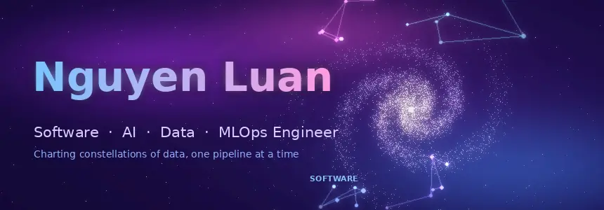
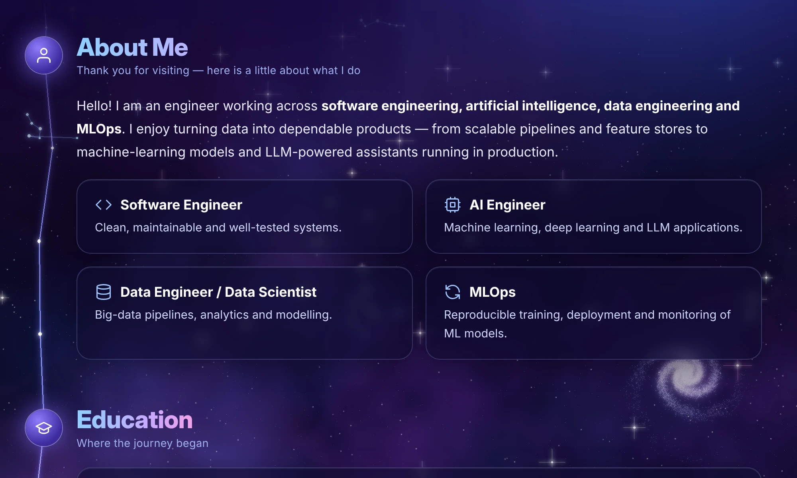
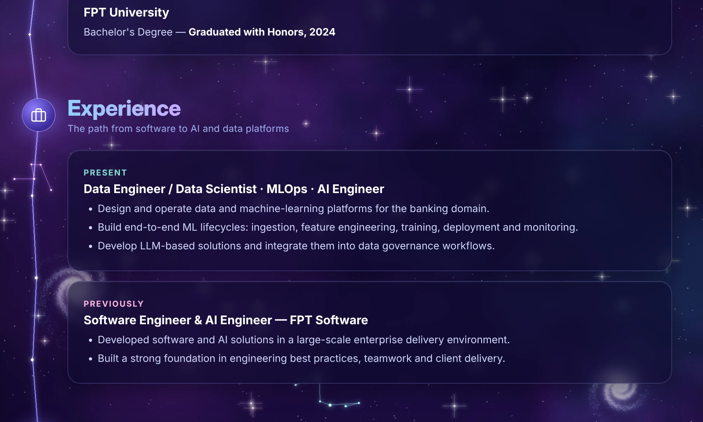
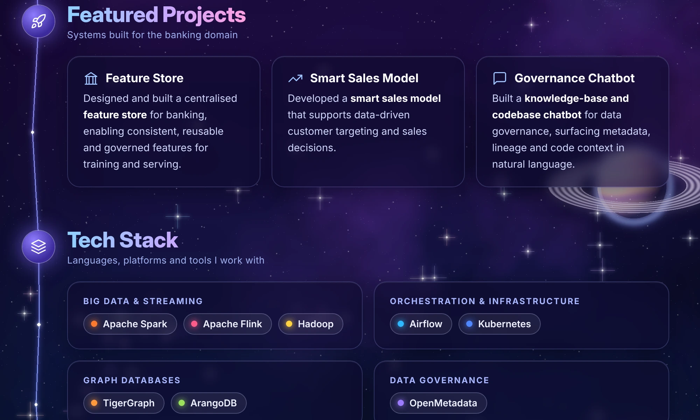
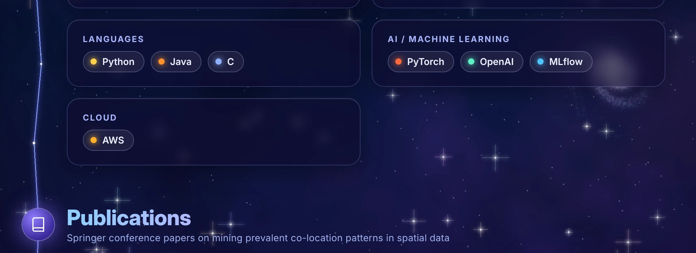
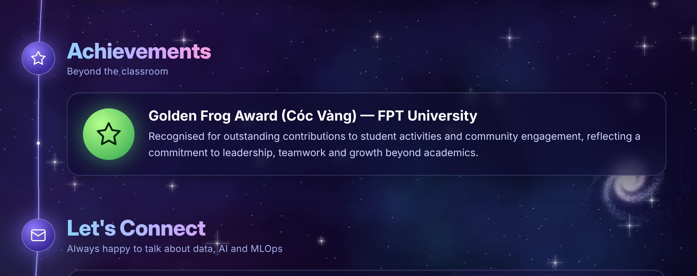

📄 Text version (for accessibility and search)

## Nguyen Luan — Software · AI · Data · MLOps Engineer

**About.** Engineer working across software engineering, AI, data engineering and MLOps — building dependable data platforms, machine-learning models and LLM-powered assistants.

**Education.** FPT University — Bachelor's Degree, Graduated with Honors (2024).

**Experience.**
- *Present* — Data Engineer / Data Scientist, MLOps, AI Engineer.
- *Previously* — Software Engineer & AI Engineer at FPT Software.

**Projects (banking domain).** Feature store · Smart sales model · Knowledge-base and codebase chatbot for data governance.

**Tech stack.** Apache Spark, Apache Flink, Hadoop, Python, Java, C, Airflow, Kubernetes, TigerGraph, ArangoDB, OpenMetadata, PyTorch, OpenAI, MLflow, AWS.

**Publications (Springer).**
- [Efficient Redundancy Elimination to Discovering Concise Prevalent Co-location Patterns](https://link.springer.com/chapter/10.1007/978-981-96-0026-7_9) — Nov 2024
- [MTRM: A Web-Miner Multi-Threshold Mining Co-location Patterns to Mitigate Redundancy](https://link.springer.com/chapter/10.1007/978-981-96-1483-7_23) — Feb 2025
- [MPCPM: Multi-level Prevalent Co-location Pattern Miner](https://link.springer.com/chapter/10.1007/978-981-97-7244-5_24) — Aug 2024

**Certification.** [AWS Certified Machine Learning – Associate](https://www.credly.com/badges/8e6de093-7997-4c3c-baea-2114f6b6cd9b)

**Achievements.** Golden Frog Award (Cóc Vàng), FPT University.

**Contact.** [github.com/NguyenLuan16](https://github.com/NguyenLuan16)

